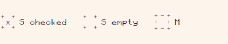
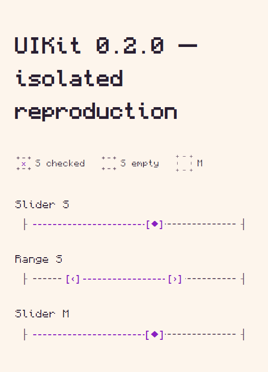

## Проблема

В `svelte-ascii-ui@0.2.0` у Checkbox `size="s"` пропадают средние вертикальные штрихи рамки; видны главным образом четыре угла. Также отсутствуют средние горизонтальные сегменты. Вариант M рядом выглядит иначе. Это заметно в настройках «Стоимость жизни / аренды» сервиса выбора города.

Пользователь также сообщает, что при обычном браузерном zoom штрихи появляются и снова исчезают на разных процентах. **Этот цикл native browser zoom пока не подтверждён автоматизированно:** ниже отдельное воспроизведение при 100% и серия CSS `zoom`, которая не эквивалентна браузерному масштабированию.

## Среда и воспроизведение

- Windows; Playwright Chromium 153.0.8010.12, headless; viewport 1200×1000, DPR 1.
- Svelte 5.57.3; UIKit 0.2.0; Checkbox S checked/unchecked и M для сравнения.
- Только публичные экспорты и fonts.css. Отдельный Vite-пример, без Tailwind, CSS приложения или внутренних overrides.
- Шрифт текста Monocraft, стандартная ASCII-графика UIKit.

```svelte
<script>
  import 'svelte-ascii-ui/fonts.css';
  import { Theme, Checkbox } from 'svelte-ascii-ui';
  let checked = $state(true);
</script>

<Theme
  palette="paper"
  colors={{
    background: '#fdf5ec',
    surface: '#edcdbd',
    text: '#281e30',
    muted: '#685268',
    accent: '#8b20c2',
    danger: '#a73237',
    warning: '#805500',
  }}
>
  <div style="display:flex;gap:24px;padding:24px;background:var(--bg)">
    <Checkbox size="s" label="S checked" bind:checked />
    <Checkbox size="s" label="S empty" />
    <Checkbox size="m" label="M" />
  </div>
</Theme>
```

1. Открыть пример в Chromium при 100%.
2. Сравнить центральные сегменты каждой стороны рамки S и M.
3. Переключить checked/unchecked.
4. Дополнительно проверить настоящий browser zoom 80/90/100/110/125/150/175/200% и Windows scaling 100/125/150%. Поведение этой матрицы пока неизвестно, не выдаём CSS zoom за такую проверку.

**Ожидание:** рисунок рамки узнаваем и стабилен, сегменты не исчезают из-за размера или масштаба. Меняется масштаб, а не состав рамки.

## Доказательства





[Все замеры, включая CSS zoom 100/110/125/150/175/200%](screenshots/uikit-020-defects/measurements.json).

[Превью приложения](https://dogs-go-to-heaven-git-codex-a-96bb38-igor-lopatinskiis-projects.vercel.app) (защищено входом Vercel; изображения и минимальный пример доступны без него).

## Диагноз и границы

Подтверждено: при 100% S — 26×26 CSS px, border 6px, border-image-width 9px, slice 12, repeat `space`; у M — 30×30px. Вероятная причина — недостаток места между угловыми фрагментами для повторяемого центрального фрагмента SVG: `26 − 2×9 = 8px`. Это гипотеза для проверки, не утверждение о доказанной причине всех zoom-эффектов.

[Checkbox.svelte v0.2.0](https://github.com/IgorLo/svelte-ascii-ui/blob/v0.2.0/src/lib/forms/Checkbox.svelte), [theme.css](https://github.com/IgorLo/svelte-ascii-ui/blob/v0.2.0/src/lib/theme.css), [theme.ts](https://github.com/IgorLo/svelte-ascii-ui/blob/v0.2.0/src/lib/theme.ts).

Смена контраста не возвращает отсутствующую геометрию. M полезен как контроль, но массовое увеличение плотных форм — не исправление S. Патчи внутренних стилей в приложении не вводились.

Поиск по всем issues выполнен: #6 — hover, #14 — shrinking рядом с длинной подписью; это другие дефекты. Прямого дубликата не найдено.

## Приёмка

- Проверить и зафиксировать стабильную рамку S/M/L при перечисленных zoom и DPR; checked, unchecked, indeterminate, disabled, hover, focus.
- Не ухудшить клавиатурный фокус, touch-target и отсутствие сдвига размеров.
- Добавить визуальную регрессию на центральные сегменты маленькой рамки, а не только на размер bounding box.

Приоритет: P2, визуальный дефект. Работа переключателя не заявляется сломанной.
