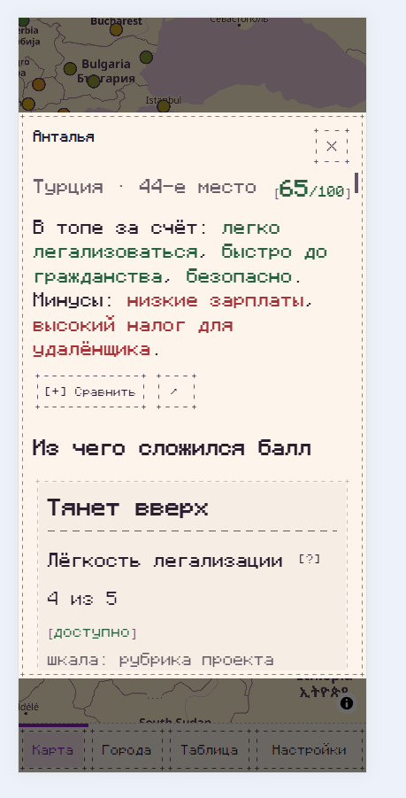

# Dialog / Drawer: поддерживаемая нижняя шторка на мобильном

Тип: missing capability / design question. Потребитель: «Все псы попадают в рай», просмотр подробной карточки города поверх карты. Пакет: `svelte-ascii-ui@0.2.0`.

## Наблюдение

На телефоне длинная карточка города открывается посередине экрана: под ней остаётся затемнённый участок карты и навигация. Пользователь ожидает шторку, прижатую к нижнему краю. Это пожелание к мобильному паттерну, а не утверждение о нарушении стандарта или необходимости менять все Dialog по умолчанию.

Скриншот предоставлен пользователем с разрешением публикации. Браузер, ОС, реальный viewport и DPR неизвестны. Тема потребителя — собственная светлая Calm Sunset, Monocraft; Dialog size="s". Полный сценарий после релиза: https://dogs-go-to-heaven.vercel.app/ — открыть карту на узком экране, выбрать город.

## Воспроизведение и ответственность

Публичная композиция потребителя на мобильном: `<Dialog open={true} title="Анталья" size="s" class="m-auto">…длинное содержимое…</Dialog>` (класс Tailwind). На desktop используется Drawer.

Центрирование явно задано приложением через `m-auto`; это не доказательство бага позиционирования UIKit. В установленном Dialog мобильный max-height равен 75dvh; Drawer поддерживает side только left/right. Отдельного публичного bottom-sheet режима не нашли. Позиционирование через переданный class потенциально возможно, но полноценный паттерн с safe-area и прокруткой не проверен; внутренние стили библиотеки не переопределяли, временный workaround не вводили.

Просьба предложить поддерживаемый способ: нижний Drawer / Sheet либо документированную композицию Dialog через публичный API. Центрированные подтверждения и desktop Drawer должны сохранить свой сценарий. Поиск среди открытых issues не нашёл дубля; #20–22 касаются геометрии контролов и типографики.

## Ожидаемый результат и проверки

- На узком экране нижний край шторки совпадает с нижним краем доступного viewport; нет пустого затемнённого зазора под карточкой.
- Длинный текст прокручивается внутри, заголовок и закрытие доступны, safe-area устройства учтена.
- Не сломаны focus trap/возврат фокуса, Escape, закрытие по backdrop и блокировка прокрутки подложки.
- Проверены короткое/длинное содержимое, портрет/ландшафт, экранная клавиатура и изменение высоты viewport.
- Desktop left/right Drawer и обычный центрированный Dialog не меняются неожиданно.

Приоритет: улучшение UX, не блокирует текущий релиз. Drag-to-dismiss не является обязательным требованием этого запроса.
