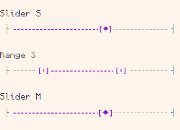
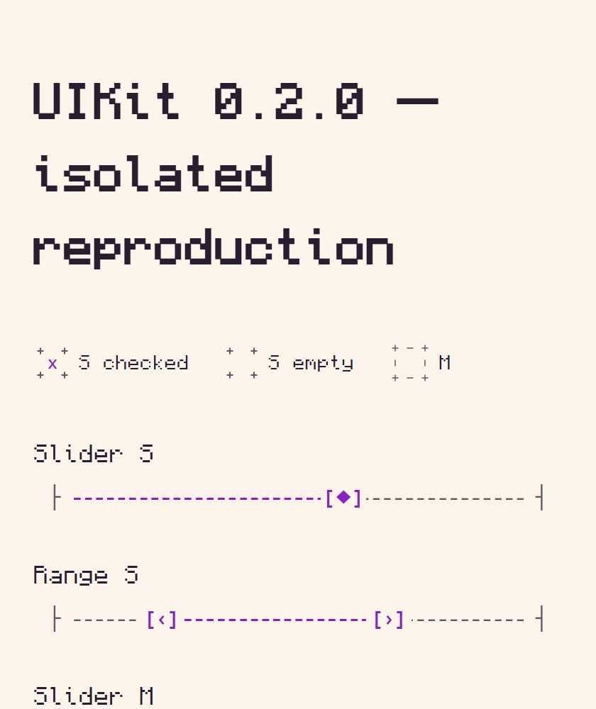

## Проблема

У Slider и Range в `svelte-ascii-ui@0.2.0` торцевые символы `├` / `┤` отделены заметным пробелом от пунктирной дорожки. Их короткие горизонтальные штрихи визуально находятся чуть выше штрихов дорожки: шкала выглядит собранной из несостыкованных частей. Наблюдается на ползунке важности и двухстороннем диапазоне в настройках сервиса выбора города.

Это отдельная проблема геометрии, а не оттенка accent. Более насыщенный акцент приложения улучшает различимость выбранного участка, но не устраняет стыки.

## Среда и минимальный пример

Windows, Playwright Chromium 153.0.8010.12 headless, viewport 1200×1000, DPR 1, CSS zoom 100%. Svelte 5.57.3, UIKit 0.2.0. ASCII-графика использует штатный `Consolas, monospace`, 16px/20px; текст — bundled Monocraft. Изолированный Vite-пример без стилей приложения/Tailwind и без overrides.

```svelte
<script>
  import 'svelte-ascii-ui/fonts.css';
  import { Theme, Slider, Range } from 'svelte-ascii-ui';
  let value = $state(6);
  let lower = $state(20);
  let upper = $state(70);
</script>

<Theme
  palette="paper"
  colors={{
    background: '#fdf5ec',
    surface: '#edcdbd',
    text: '#281e30',
    muted: '#685268',
    accent: '#8b20c2',
    danger: '#a73237',
    warning: '#805500',
  }}
>
  <div style="width:420px;padding:24px;background:var(--bg)">
    <p>Slider S</p>
    <Slider size="s" min={0} max={10} bind:value aria-label="Weight" />
    <p>Range S</p>
    <Range size="s" bind:lower bind:upper label="Interval" />
    <p>Slider M</p>
    <Slider size="m" value={60} aria-label="Weight M" />
  </div>
</Theme>
```

1. Сравнить оба стыка дорожки и торцевых символов на Slider и Range.
2. Проверить при разных значениях бегунков, особенно не рядом с торцами.
3. Повторить на ширинах 280/420/640px, размерах S/M/L и с браузерным zoom 100/125/150/200%.

**Ожидание:** пунктир и горизонтальный штрих каждого торца читаются как одна шкала на общей оптической оси; интервал на стыке сопоставим с обычным интервалом дорожки.

## Доказательства





[Замеры элементов](screenshots/uikit-020-defects/measurements.json).

[Превью потребителя](https://dogs-go-to-heaven-git-codex-a-96bb38-igor-lopatinskiis-projects.vercel.app) (требует входа Vercel; изолированные скриншоты доступны публично).

## Диагноз

В обоих компонентах торцы заданы текстовыми символами, `left/right:10px`, а контейнер тире начинается на `26px`. В примере start bounding box x=34, width=8.796875; dashes x=50: между bounding box торца и контейнером тире остаётся 7.203125px. Видимые штрихи дополнительно зависят от метрик символов.

Центры CSS-боксов по Y совпадают; это **не доказательство сдвига layout-боксов**. На изображении смещены именно видимые горизонтальные штрихи разных глифов. Вероятная причина — сочетание отдельных глифов и отступов, но окончательное решение оставляем библиотеке. Общая SVG-геометрия или согласованные метрики — возможные направления, не обязательная реализация.

[Slider.svelte v0.2.0](https://github.com/IgorLo/svelte-ascii-ui/blob/v0.2.0/src/lib/forms/Slider.svelte), [Range.svelte](https://github.com/IgorLo/svelte-ascii-ui/blob/v0.2.0/src/lib/forms/Range.svelte).

Через публичный API можно выбирать размер/marks/значения, но нельзя выровнять внутренние торцы. Ни копий компонентов, ни внутренних CSS-патчей в приложении нет. Поиск по всем issues не выявил дубликата.

## Приёмка

- Торцы и пунктир визуально состыкованы по горизонтали и оптической оси на Slider и Range.
- Проверены S/M/L, короткая и широкая шкалы, крайние/совпавшие значения Range, DPR 1/1.25/1.5/2 и реальный browser zoom.
- Сохранены доступные имена, клавиатура, фокус, touch-target и соответствие положения бегунка значению.

Приоритет P2, визуальный дефект. Ошибки вычисления значений не заявляются. Зависимость от native browser zoom отдельно не проверялась; приложенная серия — CSS zoom.
