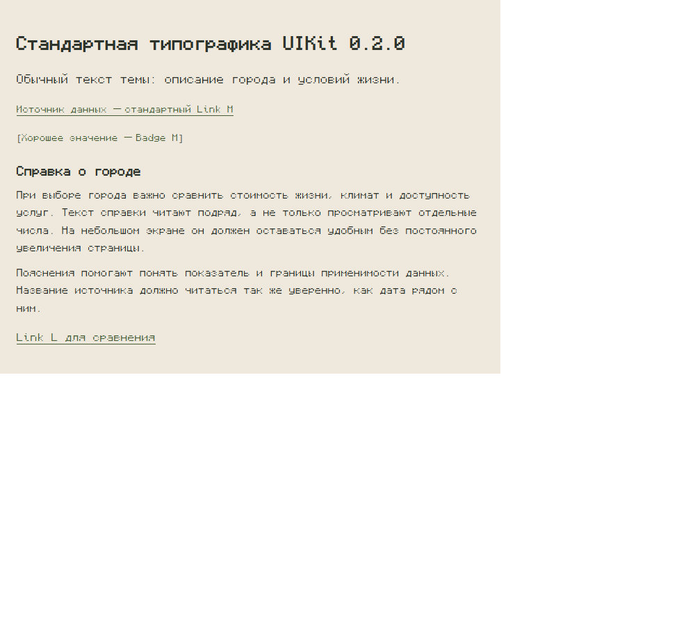
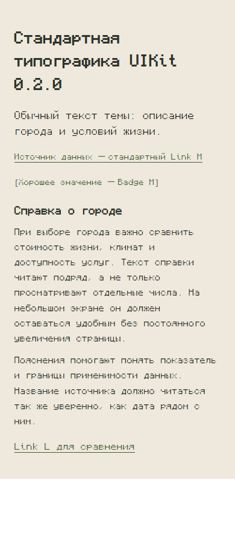
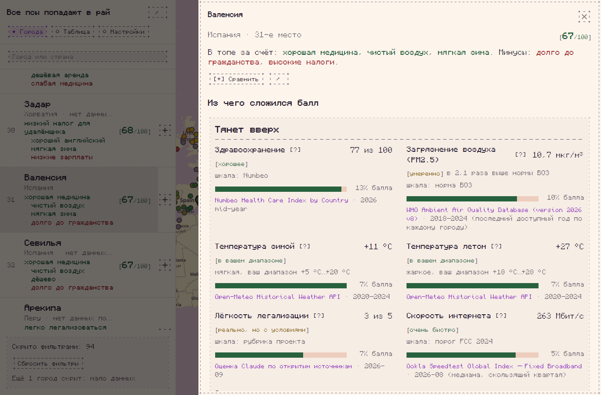
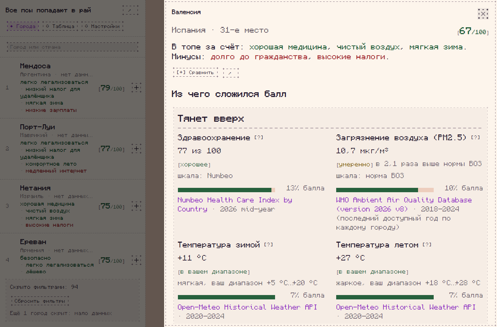
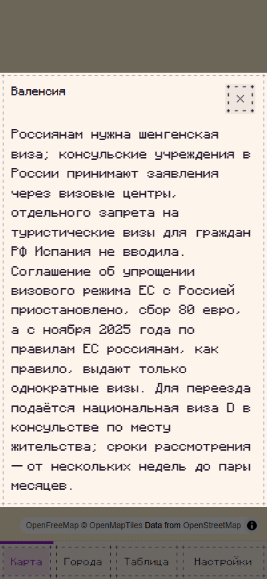

## Запрос

Пересмотреть стандартную типографику и способы настройки читаемого текста в реальных desktop/mobile раскладках. Это запрос на дизайн-аудит и развитие публичного API/гайдов, а не утверждение, что любой текст 13–14px сам по себе нарушает WCAG.

Контекст: приложение «Все псы попадают в рай», карточка города с показателями, пояснениями, источниками и длинными справками. Владелец сообщает, что текст слишком мелкий и при browser zoom 125% читать заметно удобнее. Исправление контраста и более яркий accent не устранили ощущение мелкого текста.

## Что пришло из UIKit, а что из приложения

Измерено в отдельном Vite-примере без Tailwind и стилей приложения, только публичные компоненты `svelte-ascii-ui@0.2.0` и fonts.css:

| Элемент             | Размер | Вес | Line height |
| ------------------- | ------ | --- | ----------- |
| Обычный текст Theme | 16px   | 300 | 25.6px      |
| Article paragraph   | 14px   | 300 | 25.2px      |
| Link M              | 13px   | 300 | 20.8px      |
| Badge M             | 13px   | 300 | 20.8px      |
| Link L              | 15px   | 300 | 24px        |

Результат одинаков при viewport 1000×900 и 390×900. Windows, Playwright Chromium 153.0.8010.12 headless, DPR 1, zoom 100%, Svelte 5.57.3. Шрифт Monocraft, monospace.

**Ответственность приложения:** часть подписей сама использовала Tailwind text-sm = 14px, основной текст — 16px. Это не дефект UIKit. Мы подняли эти размеры у себя.

**Наблюдение про UIKit:** Link M внутри подписи 14px сбрасывает размер до 13px — название источника мельче соседней даты. Article фиксирует 14px независимо от более крупного текста окружающей карточки. S и M имеют один размер шрифта 13px; увеличение геометрии Checkbox S→M не решает читаемость подписи. Это соответствует текущему гайду, поэтому запрос — пересмотреть контракт, а не объявить использование ошибочным.

## Минимальный пример

```svelte
<script>
  import 'svelte-ascii-ui/fonts.css';
  import { Theme, Article, Badge, Link } from 'svelte-ascii-ui';
</script>

<Theme palette="paper">
  <main style="max-width:720px;padding:24px;background:var(--bg);box-sizing:border-box">
    <p>Обычный текст темы: описание города и условий жизни.</p>
    <p><Link href="#source">Источник данных — стандартный Link M</Link></p>
    <p><Badge tone="success">Хорошее значение — Badge M</Badge></p>
    <Article>
      <h3>Справка о городе</h3>
      <p>
        При выборе города важно сравнить стоимость жизни, климат и доступность услуг. Текст справки
        читают подряд, а не только просматривают отдельные числа. На небольшом экране он должен
        оставаться удобным без постоянного увеличения страницы.
      </p>
      <p>
        Пояснения помогают понять показатель и границы применимости данных. Название источника
        должно читаться так же уверенно, как дата рядом с ним.
      </p>
    </Article>
    <p><Link size="l" href="#source">Link L для сравнения</Link></p>
  </main>
</Theme>
```

Проверить: длинные кириллические и латинские подписи, источник рядом с датой, абзацы Article, соседство Badge и обычного текста. Сравнить узкий экран и широкую карточку с двумя колонками показателей, browser zoom 100/125/150% и разные DPR. Многобраузерная и аппаратная матрица пока не проверена.

## Примеры




[Машинные замеры](screenshots/typography/kit-defaults.json).

До адаптации приложения:


После адаптации приложения, как предмет обсуждения, а не обязательный дизайн UIKit:



В приложении основной текст стал 20px, подписи и Article — 17.5px, содержимое Badge — 16.25px. Источники и даты читаются в одной шкале. Использованы собственные вложенные текстовые элементы через snippets; внутренние CSS-селекторы, копии компонентов и патчи пакета не применялись. Остальные контролы сохранили прежние размеры; Checkbox отдельно переведён на M (см. #20).

[Превью приложения](https://dogs-go-to-heaven-git-codex-a-96bb38-igor-lopatinskiis-projects.vercel.app) требует входа Vercel; изображения доступны без входа.

## Предложение к разбору

1. Проверить размеры и веса не только в каталоге отдельных компонентов, но и в плотной панели настроек, списке, таблице, карточке показателей и длинной справке.
2. Определить, какие тексты должны наследовать окружающую типографику, а какие действительно должны быть привязаны к размеру контрола. В частности, Link без button-режима и Article.
3. Рассмотреть читаемую шкалу body/caption/source/status и публичную настройку плотности/типографики без внутренних CSS-overrides. Не требуем просто увеличить всё глобально.
4. Описать выбор размеров и веса Monocraft в гайде: когда разумны 13/14px Light, когда нужен более крупный текст или Regular 400.

## Проверка результата

- Storybook/пример показывает перечисленные раскладки на 360–390px и 1280–1366px, с длинной кириллицей и реальными переносами.
- Размеры, веса и наследование предсказуемы; Link-источник не становится неожиданно мельче соседней даты.
- Контролы не приходится искусственно увеличивать ради читаемого текста справки.
- Сохраняются reflow, клавиатурный фокус и увеличение браузером без горизонтального переполнения.
- Решение документировано: изменение defaults, поддерживаемая настройка или явная рекомендация потребителю.

Поиск дубликатов выполнен: связанный #15 (Monocraft и S/M/L) закрыт; отдельного запроса на такой аудит читаемости не найдено. Приоритет: UX/design follow-up; объективные размеры отделены от субъективной оценки удобства чтения. Сам по себе этот отчёт не доказывает нарушение стандартов доступности.
